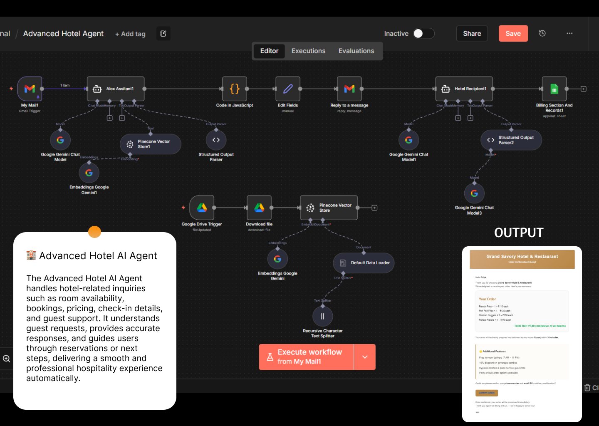

# Lead Qualification Agent

Reads new enquiries from a Gmail inbox, decides whether each lead is hot, warm or cold, replies in the right tone and logs the lead to Google Sheets.

## How it works

1. Gmail trigger watches the inbox for new enquiries
2. An OpenAI model classifies the lead as hot, warm or cold
3. A separate AI agent for each lead type extracts budget, needs and urgency as structured data
4. Sends a tailored reply in the same thread
5. Appends or updates the lead in a Google Sheet

## Built with

Gmail, OpenAI (chat model, agents, structured output), Google Sheets

## Set it up

1. In n8n, open **Workflows → Import from file** and choose `workflow.json`.
2. Connect your own credentials: Gmail OAuth, OpenAI API key, Google Sheets OAuth.
3. Replace the example email addresses and sheet IDs with yours.
4. Run it once with test data, then activate it.
